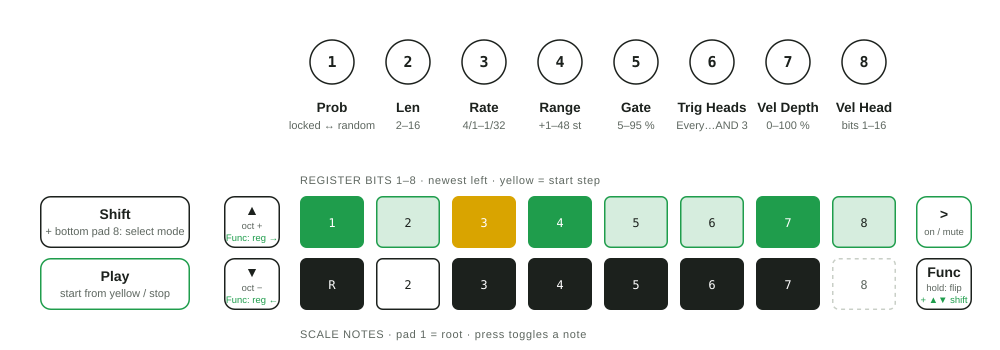

# Launchkey Mini MK4 Custom Firmware

Custom firmware for the **Novation Launchkey Mini MK4** (25 and 37 keys), built by patching the official
firmware version 1.3 build 1563. It adds:

- **Turing Machine mode** – a generative sequencer inspired by the Music Thing Turing Machine, on pad mode
  Custom 4
- **Scale memory** – the scale (on/off, type, root note, mode) is restored at power-on
- **Settings screens without switching off** – Shift + Scale / Shift + Arp open the Scale / Arp settings
  (press again to close). Shift + Scale switches the scale on (its settings only apply while it is on) but
  never off; Shift + Arp leaves Arp and Latch as they are. On the Arp screen the encoder arrows set
  Latch: **up = on, down = off**, and the arrow of the current setting is lit
- A **CFW badge** on the boot logo, and the version shown at boot gets a `+cfw` suffix

> ⚠️ **Use at your own risk.** Flashing modified firmware can leave the device unusable and may void your
> warranty. Read [Safety & recovery](#safety--recovery) before your first upload.

---

## Turing Machine mode

Select it like any pad mode: **hold Shift and press the 8th pad of the bottom row (pad mode Custom 4)**.
The display shows "Turing Machine" with short labels of the eight encoders. The sequencer starts **stopped**;
press **Play** to start it.

A 16-bit shift register loops and, depending on the probability, flips the bit that comes round again. Its
value picks a note from the current scale, and trigger heads decide whether a step plays a note.



### Pads and buttons

| Control | Function |
|---|---|
| Top row (green) | Register bits 1–8, moving one pad to the right per step. The **yellow** pad is the step the sequence restarts from (MIDI Start / reset), so it moves along too. Dark = beyond the loop length. |
| Bottom row (white) | **Scale notes** (pad 1 = root, pad 8 = 8th note of 8-note scales). Press to switch a note on (bright) or off (dim); pads beyond the scale are dark. A disabled note is replaced by the closest enabled note. With Scale off all eight pads are lit and all 12 semitones are used. |
| **Play** (transport) | **Start / stop** the sequencer, in every pad mode. Start begins at the first step of the loop (the yellow pad) on the next clock tick. Without a DAW connection Play also sends MIDI Start / Stop as usual. |
| **>** (above Function) | **Enable / disable** the sequencer (bright = enabled). Disabled **mutes** its notes; everything else keeps going (clock, Play, MIDI Start / Stop, the pattern on the pads), so enabling it again brings the notes back in time. Saved. |
| **Function** (next to the pads) | **Hold.** While held, the pads show the loop in playing order starting from its first step: pad 1 (yellow) = step 1, then left to right, top row = steps 1–8, bottom row = 9–16. The **playhead** (the step playing now) is mint, or amber when it is on step 1. The view stays put while the sequence runs (only bits that randomly change update), and pressing a pad **flips that step**. |
| **Up / Down arrows** (next to the pads) | **Octave** −4 to +4 (0 = lowest note MIDI 48 + root, the keyboard's default octave; an arrow is dim when the end is reached). |

### Encoders

| Encoder | Parameter | Range |
|---|---|---|
| 1 | Probability | right = locked loop, middle = random, left = locked and inverted (twice as long) |
| 2 | Length | 2–16 steps |
| 3 | Rate (turn right = faster) | 4/1, 2/1, 1/1, 1/2, 1/4, 1/4T, 1/8, 1/8T, 1/16, 1/16T, 1/32 |
| 4 | Range | +1 … +48 semitones above the root (+12 = one octave, +24 = two, +36 = three, +48 = four); the register picks a pitch in that span and it is moved to the closest enabled scale note (staying inside the span when possible) |
| 5 | Gate length | 5–95 % of a step (notes are never tied) |
| 6 | Trigger heads (turn right = sparser) | **Every** step · **OR 3** (~88 %) · **OR 2** (~75 %) · **Bit 1** (~50 %, like the module) · **XOR** (~50 %, different rhythm) · **AND 2** (~25 %) · **AND 2+** (~19 %) · **AND 3** (~12 %). The heads sit at fixed fractions of the loop (start, ½, ⅓ and ⅔, ¼ and ¾) and combine what they read, so the rhythm loops and mutates with the pattern at any length. |
| 7 | Velocity depth | Fixed (velocity 100) … 100 % in 5 % steps: blends in a velocity read from a 7-bit window of the register (see encoder 8), so accents loop and change with the pattern |
| 8 | Velocity head | Moves the window the velocity is read from (shown as "Bits 5-11" … "Bits 10-16", then "Bits 1-7" … "Bits 4-10"): each position gives a different accent pattern from the same loop. Only audible with velocity depth above 0. |

Turning an encoder shows its value on the display.

### Good to know

- **Tempo** follows the device: the internal tempo, or external MIDI clock when connected.
- **MIDI transport:** Start goes back to the first step of the loop (the yellow pad) and plays it on the
  next clock tick (the downbeat), Continue resumes, Stop pauses – also while another pad mode is selected or the sequencer is disabled.
  The **Play** button does the same as Start / Stop.
- **Running in the background:** once started, the sequencer keeps playing after you switch to
  another pad mode; its pads, buttons and popups only show while Turing Machine mode is selected.
- **Notes** go out on the **Turing Channel** via USB MIDI and the TRS MIDI out (velocity: see encoders 7 and 8). Set it in
  **Settings**: it is the last item, after "Power On Modes" – use the down arrow to get there (default 1).
- **All parameters and the scale-note selection are saved** and restored at power-on (about 3 seconds after
  the last change). The running pattern and start/stop are not saved;
  enable/disable is.
- **Shift still works:** Shift + pads selects pad and encoder modes as usual, and menus (Settings, Scale, Arp)
  get the encoders while they are open. If a Scale or Arp screen keeps the encoders, select pad Custom 4 again.
- **Shift:** the pad that selects Turing Machine mode (8th pad, bottom row) is **bright green** while the
  sequencer is enabled and **dark green** while it is disabled (muted).
- **Shift + turn an encoder** shows the current value of that Turing Machine parameter without changing it.

---

## Requirements

| Tool | Install |
|---|---|
| [uv](https://docs.astral.sh/uv/) (Python and dependencies) | `brew install uv` |
| `make`, `clang` (Xcode command line tools) | `xcode-select --install` |
| `ld.lld` (links the custom code) | `brew install lld` |

One-time setup:

```sh
uv sync
```

---

## Build and flash

```sh
make inquiry      # check the connection: "Launchkey Mini MK4 25, firmware 1.3 build 1563"
make patched      # build build/patched.syx (all checks must pass)
make upload       # flash it (asks for confirmation first)
make restore      # flash the original Novation firmware again
```

`make upload` lists the version and the features (patches) contained in the file before asking. Then:

1. The device may show **"Press to Upgrade"** – press it within the timeout. The uploader waits 120 seconds
   (`--confirm-timeout 300` for longer).
2. The upload takes about 30 seconds and the device restarts by itself.
3. The boot screen shows `Ver: 1.3.1563.<n>+cfw`, where `<n>` is the number of patches.

Before uploading:

- Connect the Launchkey **directly** (no hub) and keep the computer awake.
- **Quit every app that uses the Launchkey** (DAWs, Novation Components, browser tabs with Web MIDI).

If the uploader reports **no "ready"**, nothing has been written: check the points above and run
`make upload` again. If it stops **in the middle**, don't unplug the device – run `make upload` or
`make restore` again right away.

Uploader options (`uv run python tools/send_syx.py build/patched.syx [options]`):

| Option | Effect |
|---|---|
| `--dry-run` | only check the file and list its contents |
| `--yes` | don't ask for confirmation |
| `--confirm-timeout 300` | wait longer for "Press to Upgrade" |
| `--port "MK4 37"` | choose the port by name |
| `--list` | list all MIDI ports |

---

## Customising the boot logo

`assets/boot_logo.txt` is the 128×48 boot logo as ASCII art (`#` = pixel on, `.` = off). Edit it without
changing its size, then `make patched`. The original logo is in `assets/boot_logo.orig.txt`.

---

## Safety & recovery

- The update only rewrites the application area. The bootloader is never touched.
- Uploads only start after the device replies "ready" and stop at the first missing acknowledgement.
- To go back to the official firmware: `make restore`, or use
  [Novation Components](https://components.novationmusic.com).
- If the device doesn't start after an upload: unplug and reconnect it. If it still doesn't start, it needs
  Novation's bootloader/update mode (a button combination held while connecting USB – see Novation's support
  pages for the Launchkey Mini MK4) and then the original firmware.
- Never flash a file that `make patched` did not build and check.
